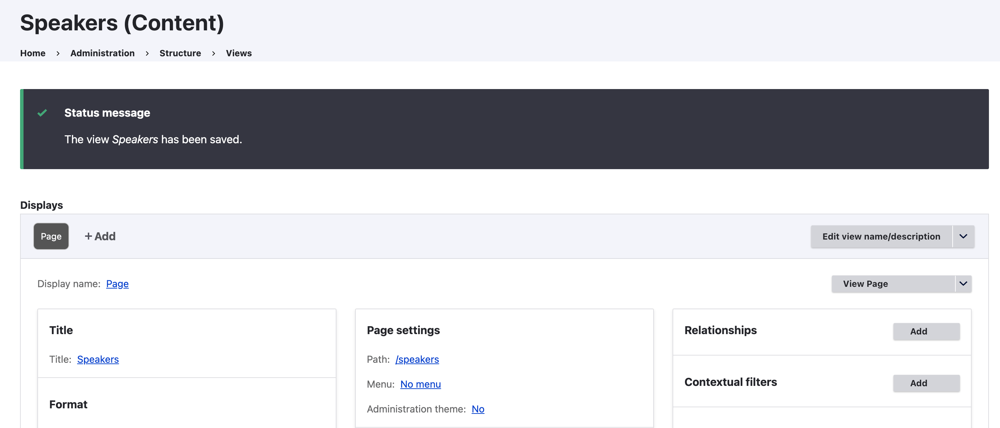

# Configure the view

The Views setting page contains all of the settings and options to configure and customise a view, broadly broken into three columns.

<figure><figcaption></figcaption></figure>

The **left-hand column** contains data and display settings. This includes how the content will be formatted, what data will be displayed and how it can be filtered and sorted.

The **middle column** contains the top-level display settings, such as what page or menu the view will display in, if there is a header or a footer above and below the view, as well as what happens when no content is visible, and pager settings.

The **right-hand column** contains advanced settings such as the field relationships, contextual filters and query and cache settings.

In addition, there’s also the **Display bar** at the top, which allows you to add additional displays. For example this is currently being displayed as a page, however later we will add other display methods.

If you scroll to the bottom of the page you’ll see a **preview of the view**.

Let’s look at each section in more detail.

### Display settings

<figure><figcaption></figcaption></figure>

#### Title

The title content will be displayed with the view, wherever titles are normally displayed such as a page or block title. This is automatically inherited from the view name, but it can be edited and changed.

#### Format

Under the Format heading we can change the option we selected when we created the view by changing the **format** from **unformatted list**. Additionally using the **Settings** option you can group results together based on field output, and add additional CSS classes.

You can also change the **Show** option from Field to Content, and then rather than configuring the **fields** that will display, you can choose which **display mode** of the content type will be used instead, such as teaser or full content.

#### Fields

If you have fields selected you can add and customise which fields will appear in your view. Every field in your content type will be available and can be customised independently.

In this example we’re going to add the **Photo** and **Short summary** fields.

To add a new field, select the Add button located to the right of the Fields label.

<figure><figcaption></figcaption></figure>

Using the search bar, you can search for field names, then use the checkboxes to select multiple items.

In this instance, we’re adding both the **Photo** and the **Short summary** fields.

<figure><figcaption></figcaption></figure>

Once those fields are checked, select Add and configure fields.

This next screen allows you to configure the fields you’re adding.

The title at the top shows we’re configuring the first of the two fields we’re adding.

<figure><figcaption></figcaption></figure>

Each field type has its own configuration options.

For the **Photo** field, we can change the **Formatter** from Label to **Thumbnail** which will allow us to use an **Image style**. Once the image style of choice is chosen, select **Apply and continue** to continue to the next field.

The **Short summary** field is a rich text field. While we have called the field Short summary, we can't restrict content authors to a set character limit, but we can truncate the output of the field. To do that we can change the **Formatter** from Default to **Trimmed**. Then we can set the maximum length of this field.

This option is useful for listing pages where you want a consistent layout.


Additional configuration options are available for all fields such as wrapper elements, CSS classes, and the ability to rewrite or slightly format the text.


When complete, select the **Apply** button.

#### Filter criteria

Continuing below the fields section we have filter criteria.

<figure><figcaption></figcaption></figure>

**Filter criteria** allows you to filter the list of results. Without a filter, the view would return every piece of content on the website.

Luckily our filter is already set for Published Speaker content, so we don't need to do anything.

However, you could add a filter similar to how you added a field by selecting Add.


We will add filters in an upcoming section.


#### Sort criteria

The last section allows us to sort the responses based on a criteria. By default content is sorted by most recently authored first, however for our Speakers lets change this to alphabetically.

<figure><figcaption></figcaption></figure>

Select the Content: Authored on (desc) item to open that Sort criteria and select the red Remove button in the lower right. This will remove the sort and leave the section empty.

Select the **Add** button and find the **Title** field. You can use the Search field to filter your results, check the associated checkbox and then select the **Add and configure sort criteria** button.

<figure><figcaption></figcaption></figure>

You then need to configure the criterion. For our use case, Sort ascending will work, so select **Apply** to continue.

<figure><figcaption></figcaption></figure>

If you scroll to the bottom of the page, we can see our **Preview**.

<figure><figcaption></figcaption></figure>


Any time you make any changes, make sure you select the Save button to save your changes, or the Cancel button to revert any changes you’ve made.


There are two small tweaks we are going to make to make our View slightly better.

First, the titles are just displaying as linked paragraph text, when each item should have its own heading. And secondly, the first item in our list is missing a Short summary (Because that node doesn't have any text in that field) so we will provide a fallback.

Scroll back up to Field settings and select the Title field.

<figure><figcaption></figcaption></figure>

Expand the Style settings accordion to check the Customize field HTML option. Use the select list to select the HTML element of H2.

This will wrap our field with a \<h2> element, making it a Heading 2, which will semantically be displayed after our \<h1> heading of the page title.

<figure><figcaption></figcaption></figure>

Select **Apply**, and then scroll down to the Preview to see how this has changed our display.

Next we need to provide a fallback for when the Short summary field is missing content. In our use case, we are going to fall back to providing a selection from the main Biography field.

So scroll back up, Add a new field and select Biography and select **Add and configure fields**.

<figure><figcaption></figcaption></figure>

Scroll down and expand the Rewrite results accordion. This will allow us to alter the output of this field. Because we don't want the entire Biography, we will check Trim this field to a maximum number of characters and enter in the same value we used for the Short summary.

<figure><figcaption></figcaption></figure>

If you select Apply, and scroll down, we can now see both fields being display.

To fix this, scroll back up, select the **Biography** field, and check **Exclude from display**. This will remove the field from being displayed, but still give us access to it in configuration. Select **Apply**.

<figure><figcaption></figcaption></figure>

With the field now not being displayed, we need to tell the Short summary field to use it, however, Views processes all its fields in order from top to bottom. In order for the Short summary field to be able to take in data from the Biography field, we need to rearrange them so that Biography is before Short summary.&#x20;

Select the arrow beside Add and then select Rearragnge.&#x20;

<figure><figcaption></figcaption></figure>

Use the row control widget and **drag Biography** to be anywhere **above the Short summary** field and select **Apply**.

Now that our fields are in the right processing order, select Short summary and **expand the No results behaviour accordion**.

<figure><figcaption></figcaption></figure>

As the title suggests, this configuration allows you to display something **when no value is available**. In our scenario we want to display our newly requested trimmed Biography field instead of nothing.

The help text suggests that this field can source Tokens from the Replacement patterns accordion in the above section. So expand the Rewrite results section and temporarily enable Override the output of this field with custom text checkbox, this will display another accordion for **Replacement patterns**.

<figure><figcaption></figcaption></figure>


Yes this is annoying and frustrating, but until you memorise the replacement pattern syntax, this is the easiest way to get the data.


Here we can see the Biography field can be represented with the token of **\{{ field\_c\_n\_body \}}**. Copy that value, scroll down and paste it into the **No results text** field.

Once that is in there, make sure you **uncheck** **Override the output of this field with custom text**, and then select **Apply**.

Now when we scroll down and view the **Preview** section, each Speaker has just the **single text field**.


Remember, when making changes to a View, you need to **select the Save button** for those changes to be made permanent.


### Page settings

<figure><figcaption></figcaption></figure>

This section is different depending on what type of View you are creating. Because we have created a Page view, we are able to determine the **Path**, **Menu** location and if the **Administration theme** should be used when viewing the page (Handy for creating custom Admin pages).

Below that is **Access**, which allows you to determine what access levels are needed to see the view. For any public-facing view, leaving this as ‘View published content’ is the correct option.

Header and footer allow you to provide content that will be displayed above or below the actual content list itself.

In this example we’re going to add a header that shows how many items are in the list.

To do that, select **Add** beside the **Header** title.

As with the other screens you can search for the available options. In this example we’re going to search for and add a **Result summary**, and then select **Add and configure header**.

<figure><figcaption></figcaption></figure>

In the content field you can provide text that will appear at the top of the view.

Just like the No results text earlier, here we can also use replacement tokens which are listed out below the field. We can enter the text:

```
There are currently @total speakers for our events.
```

And then select **Apply**.

<figure><figcaption></figcaption></figure>

If you scroll down to the View preview, you can see the Header being populated.

<figure><figcaption></figcaption></figure>

Further down the middle column, the **No results behaviour** section will display when the view returns no results. This can be handy to configure if your view has strict filters that may mean content won’t always be visible.

And finally the **Pager** settings allow you to configure how many items display per page.

For our demonstration, these default settings are fine, however feel free to alter them and play around.

### Advanced column

The final column provides additional field, filter and dispaly settings.

**Relationships** allow you to add connections to other related content. For example in this view we’re just showing Speakers, so we only have access to the fields in the Speaker content type.

However if the Speaker content type had a field that referenced another content type, we could use Relationships to tell our View to find related content from our Speaker content type and then display any field data from that linked content.

We will cover this in the upcoming [Views showing related content](views-showing-related-content.md) lesson.

Contextual filters allow us to create a View that’s filtered based on where it appears on the website. This is useful for creating lists of related content when you are viewing a specific piece of content or on a specific page. For e.g. If you are on a Speaker's page, you can create a contextual view that lists events for that Speaker **only**. At the time of creating this event list view, you would not have known which Speaker the user is viewing, therefore you can use a contextual filter which gets the Speaker from the final page, and uses that in your view to filter the results (sort of like a dynamic variable which has an assumed value of the future Speaker).


We will be creating a Related list in an upcoming section.


**Exposed form** provides some options for styling the exposed filters. Exposing the form as a block will allow us to place the form anywhere a block can be placed, allowing for filters to be displayed in a sidebar to the list, rather than at the top.

The **Other** section provides additional administrative or advanced configuration options. The most important of these is probably **Use AJAX**, however this is only required for views with exposed filters.

Enabling **Use AJAX** means that when a user selects a filter, the results are dynamically updated instead of having the page refresh, which can result in a more seamless user experience.

### Completed view

Now that the view is complete, we can first select the Save button one last time to ensure our changes have been saved, and then select the View page button in the top right to see our new view page.

<figure><figcaption></figcaption></figure>

Your view will differ depending on your **theme**, **styles** and **fields**.

<figure><figcaption></figcaption></figure>

