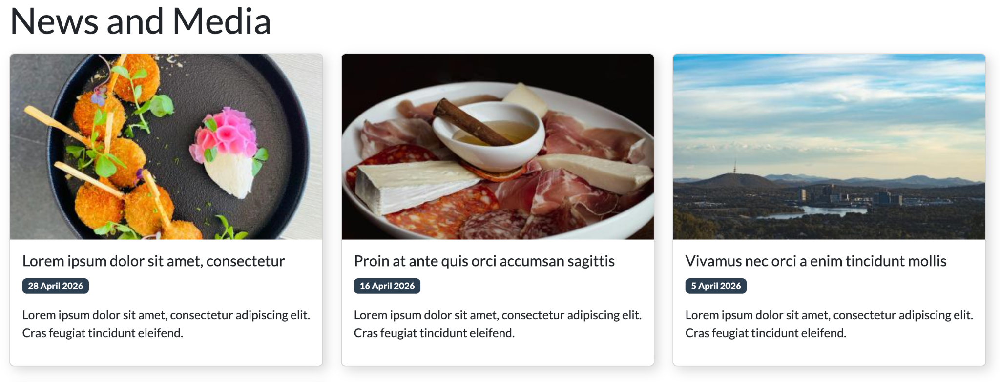

# Views overview

Views is a popular feature in GovCMS and Drupal.

Using the **Views** module, you can **create lists** of your website’s content and present it to the user.

The content display can be as varied as lists, posts, galleries, tables, maps, graphs, menu items, blocks, reports, forum posts, etc.

Views can display **any type of content**, including nodes, users and media, and they can also be filtered.

For example:

* A view of events, displayed as a list.
* Or a view of the FOI content type, displayed as a table.

* Or a view of the image media entity, displayed as a slideshow.
* Different displays can present the same query results in different layouts.

You can build a View once, and then display it as a page with a fixed URL, or a block on a landing page, or as a list of related elements in a footer.

You can also use views to implement exposed and contextual filters for **search**.

Views also let you create filters using values pulled from the content you’re viewing.

You can set up a view at the bottom of a news article to show other news articles that share similar taxonomy terms, creating a **list of related news**.

