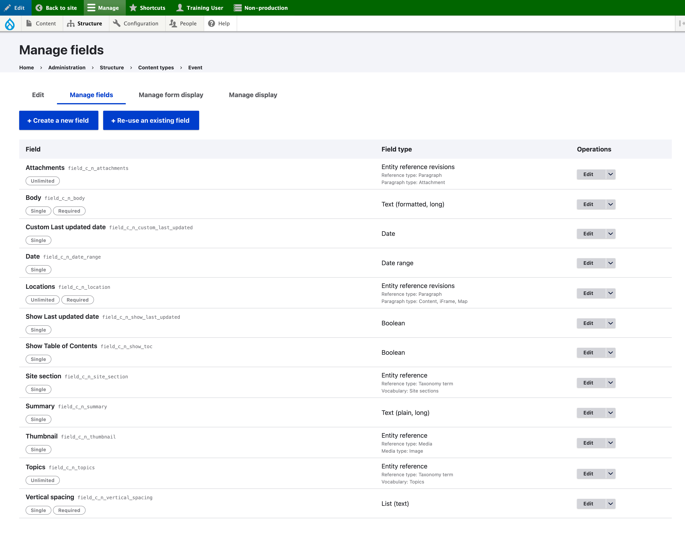

# Planning your site structure

You should plan your content types carefully, and there are a lot of things you’ll need to consider.

For example, let’s consider events on your website. If you run both online events and in-person events, you may want to create two separate content types.

However, if the only difference between the two is a physical address compared to an online meeting link, then it would probably be wise to make it a single content type that has 2 fields; one each for a physical address and a meeting link.

If the online events require registration links, downloadable resources and interactive elements, whereas your in-person events require parking information, multiple physical addresses and an event map, then separate content types might work better.

Deciding if you should build your website with two or three monolithic content types, or break these into lots of content types, needs to be considered on a case-by-case basis. It's all something developers learn with experience.

### Content editing

The fields in your content type can have different input widgets (like dropdowns or text boxes) and there are various settings for each field, such as single or multi-value, or making the field mandatory or optional.


Your developers can create code in your administration theme to alter the content editors’ experience so that certain fields in your content types are shown or hidden based on other field choices.&#x20;


This then creates a streamlined user experience for your content authors.

The screenshot below shows a snapshot of the various fields of the **Event content type**. You can see the various field types in the "Field type" column.

<figure><figcaption></figcaption></figure>
