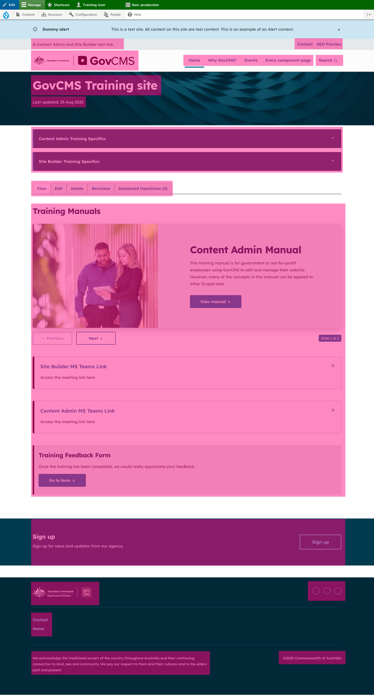

# Blocks in GovCMS

The next layer down after a region is a **block**.

Blocks are self-contained chunks of your website’s page layout that are placed inside the **regions** of your theme.&#x20;

They have **visibility settings** that determine when and where they are displayed, and can range from static content (like the site logo) to dynamic content (like the main navigation or main page content).

Below is the homepage of the training website, with each block highlighted in purple.

Take note of the various block placements, for example, the main menu may look like one block, but in fact the Search item is its own block provided by the search functionality.

And the main content area that includes the slideshow and links to the Teams meetings are all inside the one main page content block, despite appearing to be separate blocks of content.

<figure><figcaption></figcaption></figure>

Blocks are managed from two sections of your website’s CMS:

* Firstly block **content** can be created, viewed, edited and deleted from the **Content** and then **Blocks** section of your website. This page controls which blocks are in which regions.
* Secondly, each block has its own **settings** page, which controls where and when it should be displayed. It's configured via opening **Structure** then **Block** **layout**.

To view all custom blocks go to **Content** and then **Blocks**. This will take you to the block library.

<figure><figcaption></figcaption></figure>

We cover creating and managing **blocks** in an upcoming section.
