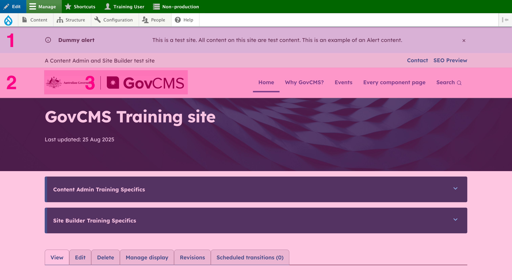

# What is a theme

Everything that you see in Drupal is displayed by a **theme**.

A theme is a set of files that define the visual look and feel of your website.&#x20;


Creation or alteration of a theme is only done in code, and as such is not covered in this training manual.


The Drupal backend, where you edit your content, determines what content (including HTML text and other data stored in the database, uploaded images, and any other asset files) is going to be displayed. The **theme** and its **regions** and **blocks** determine **where** it will be displayed.

Each theme is made up of **regions**, and each region can have **blocks** that display content.

<figure><figcaption></figcaption></figure>

In the above screenshot you can see layers of pink rectangles that each represent different layers of Drupal and how it positions and displays content.

1. The entire site **theme**
2. The header **region**
3. The logo **block**

We will cover [regions](layout-of-a-drupal-page.md) and [blocks](blocks-in-govcms.md) in upcoming sections.

By default, you have two active themes on your website, your **Administration Theme** and your **Frontend Theme**.

The default themes shipped with GovCMS are:

* Olivero - frontend theme
* Claro - administration theme


The training websites are built using CivicTheme as their frontend theme, and a slightly modified Claro theme for the administration theme.


You can use any theme you want for your website on GovCMS. You can view the [GovCMS Gallery](https://www.govcms.gov.au/gallery) to see the variety of websites all hosted on GovCMS, all visually different because of how their theme was developed and implemented.
