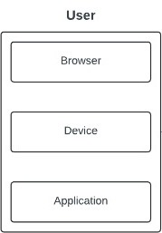

# Caching on GovCMS

Caching is the process of taking the final website from the server, and storing it in various places so that when a user requests a common page, they don’t need to wait for the Drupal website itself to load and process the request, they’re just sent a pre-rendered version.

This saves processing time and load on the server, and increases responsiveness for users.

However, it’s a **fine balance** between caching content for increased performance and ensuring that users always get the most up-to-date content. Occasionally, it needs some adjustment.

Let's look at caching on the GovCMS platform.

There are **multiple layers of caching** that happen when someone visits a website on the GovCMS platform.

1. **User-level caching**, such as browsers or devices.
2. **Network caching**, like internet service providers or firewalls.
3. Finally **GovCMS caching**, using Akamai.

Let’s look at each of these levels in more detail.

### User-level caching



This is the cache that lives inside each user's browser. We have no control over this except to hope that users refresh their browsers.

Users' devices might also hold their own cache to speed up common requests. However, similar to browsers, we have no control over their settings or the ability to flush or purge their caches at this level.

### Network caching

The next level of cache between your website and users is at the network level.&#x20;


This could be provided by the user’s internet service provider, a corporate network proxy or even a local firewall.

Again, this is a layer that we have no control over.

### GovCMS caching

After that is the GovCMS-level caching containing both the Akamai CDN, or content delivery network, and Drupal itself.



Akamai is only set up on production domains. Your secondary environments will never be cached by Akamai.


Content cached in the CDN usually has a long storage lifetime, ensuring that your website remains highly available.

However, it can become problematic if critical updates need to be pushed out, and the CDN continues to serve an older, cached version of the content.

The CDN will only fetch a fresh copy of your website content when its timer has expired. We’ll look at how to work around this in the next section.

Under Akamai is the Drupal website itself, which has its own cache.

Developers can refresh a website's Drupal cache on demand using the Lagoon UI. This can often help if you’ve pushed up a theme code change and you’re not seeing it reflected on the website.

### The three layers together

Together, these three layers form the cache infrastructure that helps support GovCMS websites.


The primary layer that we have control over is the **Akamai cache**.

However, you can purge a page from the Akamai cache.

### GovCMS Akamai purge paths

To purge a page from the Akamai cace, in the **Administration** menu, hover over **Configuration**, **Web services** and select **GovCMS Akamai Purge paths**.


Akamai purge does not work on local or secondary environments because Akamai only caches production environments. This means we can't test it fully during training.


<figure><figcaption></figcaption></figure>

In the text field, add the URLs of the pages you want to purge.

Each item should be on a new line, and it should be the URL without the domain name. For example:

```
/events/nunc-tristique-velit-et-porta-pharetra
/every-component-page
/sites/default/files/images/2025-08/site_builder.jpg
```


As you can see from this example, we can purge both content pages and uploaded files.


When your list is ready, select the **Purge** button.

The purge should happen fairly quickly, however allow up to 10 minutes if the servers are busy.

Your content should now have been purged from the Akamai cache and a new cache will be generated by the next visitor.

### Drupal caching

The final layer of caching is the Drupal cache itself.

However most of the cache options in Drupal are set by default across the platform, so you only have to worry about **views caching**.

Views caching is enabled on a **view-by-view basis** and is done by editing the view, and selecting Caching from the far-right column.

<figure><figcaption></figcaption></figure>

You’ll be given different options, depending on the view you’re editing.

For basic blocks and pages you can select between tag-based or time-based caching.

<figure><figcaption></figcaption></figure>

We recommend activating the **tag-based caching**. This will ensure proper cache expiration when your content is updated.

Tag-based caching creates a list in the view of every piece of content being referenced in that view. When any of that content is updated, the view is also refreshed.

However, on traffic-heavy websites, it may be better to use the time-based caching.

For views used as search functions, you have the option of selecting both tag-based and time-based caching, however we suggest you select one or the other.


You can tweak these over time to determine what’s best for your website.


### More information about caching

Caching is a very complicated topic with many moving parts. Since it can really only be tested on live production websites, it’s difficult to test and tweak.

For additional information please visit the GovCMS Knowledge Base and read our articles about  caching.
