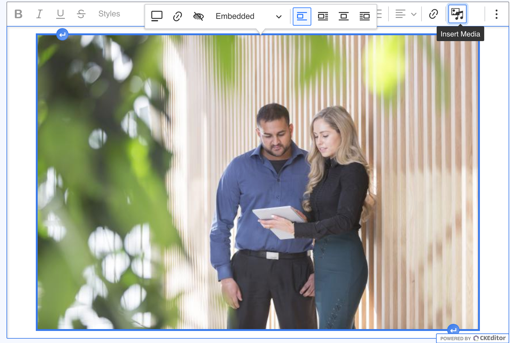

# Available toolbar buttons

This page explains the available buttons in the WYSIWYG editor.

<figure><figcaption></figcaption></figure>

### Undo/redo

Provides button versions of undo/redo, however even without these buttons enabled the functionality still works via keyboard shortcuts.

### Headings

Allows users to convert standard text paragraphs into heading levels to properly structure content.

This option also provides a plugin setting where you can define the available heading levels. By default, the Heading 1 option is disabled, as pages should only have one Heading 1 and this should be the page title.

<figure><figcaption></figcaption></figure>

### Style

The style plugin allows content editors to easily add inline CSS styles while they're editing without having to switch to source mode and manually enter HTML.

Using the helper text below the styles field, the screenshot below shows four options that users can select in the **Styles** select list.

<figure><figcaption></figcaption></figure>

The styles are: primary button, secondary button, a red Heading 2 and a blue Heading 2.

By adding the styles in here, content editors can select an A tag and use the select list to add the button classes without having to write any HTML classes.&#x20;

The options visible to the user will depend on what tag the cursor is currently in.

In the below example, the red and blue options are available because the cursor is inside an H2 tag, which gives access to the h2.red or h2.blue styles.

The primary and secondary links are disabled because I'm not currently selecting an \<a> tag link.

<figure><figcaption></figcaption></figure>

### Special characters

Using the special characters option provides content authors with a quick and easy way of inserting unique, non-keyboard characters into a text field.

You can't limit this to only certain characters.

<figure><figcaption></figcaption></figure>

### View source

View source allows content authors to view the HTML source code of the field. This button disables all other buttons until it's toggled off.

Just because a user has access to Source mode doesn't provide them unlimited HTML manipulation. For example if someone attempted to paste in any code that is not specifically allowed, it will be stripped out before it can be executed.

<figure><figcaption></figcaption></figure>

Enabling View source provides a Plugin setting that allows you to define any additional HTML tags that you would like a content author to be able to use.

The help text for the field suggests that:

> A list of HTML tags that can be used while editing source. It is only necessary to add tags that are not already supported by other enabled plugins. For example, if "Bold" is enabled, it is not necessary to add the \<strong> tag, but it may be necessary to add \<dl>\<dt>\<dd> in a format that does not have a definition list plugin, but requires definition list markup.

It is recommended that if you allow content authors the ability to edit HTML directly, that the following filters are enabled:

* Limit allowed HTML tags and correct faulty HTML\
  or
* Correct faulty and chopped off HTML

### Bold / Italic / Underline

These are basic Word processor functions that are self explanatory.

### Inline code

Wraps your selected text with the \<code> tag which allows you to provide additional styling to that element.

### Code block

Wraps an entire block of content with \<pre> and \<code> tags allowing for additional styling.

Selecting this button allows you to configure the Plugin settings and define the various formats.

This doesn't allow you to execute code, but instead adds that as a class to the \<code> element, allowing you to target it specifically with CSS or JS in order to format the text for the correct code language.

<figure><figcaption></figcaption></figure>

### Strikethrough

This is a basic Word processor function.

### Subscript / Superscript

These are basic Word processor functions that allow you to wrap text in the \ or \ tag which will change the display of the text.&#x20;

### Quote

Wraps elements in the \<blockquote> HTML wrapper.

### Link

Provides the ability to insert \<a> tags and link to internal or external pages or resources.

You should also enable the Filter called Linkit URL converter, this provides a helpful tool which allows content authors to easily link between pages inside your website using a simple autocomplete field.

Enabling the Filter allows you to configure a Plugin setting where you need to select a Linkit profile.

The Training website comes with two, and can be further customised by your developers.

<figure><figcaption></figcaption></figure>

### Unordered list / Ordered list

Another standard Word processor option, however enabling these options provides you with the following Plugin settings.

* Allow the user to reverse an ordered list
* Allow the user to specify the start index of an ordered list
* Allow the user to create paragraphs in list items (or other block elements)
* Allow the user to choose a list style type

### Horizontal line

Adds the ability to insert the \
 horizontal rule element allowing content authors to visually break up text.

### Alignment

Provides the option for content authors to change the alignment of the text. Enabling this button provides a plugin setting that allows you to configure which options are allowed:

* Left
* Center
* Right
* Justify

### Remove format

A very useful button that strips out any errant formatting that may have come across when pasting from Word.

However, we suggest content authors use **Paste as plain text** options when possible.

### Table

Adds the ability to embed a custom sized table element into the text area. The user can select the initial size when inserting, and can then add/remove rows and columns as they go.

Tables are terrible for accessibility and should really only be used for numerical data and not as a way to layout text.

### Image

**Do not** use this option as this only allows you to embed an image using the standard \ tags. Instead you should use the Media button instead as this allows you to embed a Drupal Media Entity such as an Image or Document.

### Indent / Outdent

Allows you to easy indent or outdent your ordered or unordered lists.

### Language

Currently a bug is preventing this plugin from being enabled. If you want to add additional language content to your websites, you should create specific fields for them and use other methods.

### Show blocks

A visual toggle for content authors in order to see what block elements are in the editor.

<figure><figcaption></figcaption></figure>

### Media

The correct method for embedding Media (Both images and documents) into content.

<figure><figcaption></figcaption></figure>

Enabling this button provides the following options:

* Plugin setting
  * Allow the user to override the default view mode (Can only be checked if more than one View mode is enabled in the Filter settings below)
* Enabled filters
  * Embed media (This option must be checked)
* Filter settings
  * Allows you to configure what type of media can be embedded, as well as which View modes are allowed.


This allows content authors to embed Media (images, documents, video) inside rich text fields, and allowing them to select different View modes gives them access to different image styles as we covered before with the [Speaker photo](../manage-media/customise-view-mode-for-media.md).

