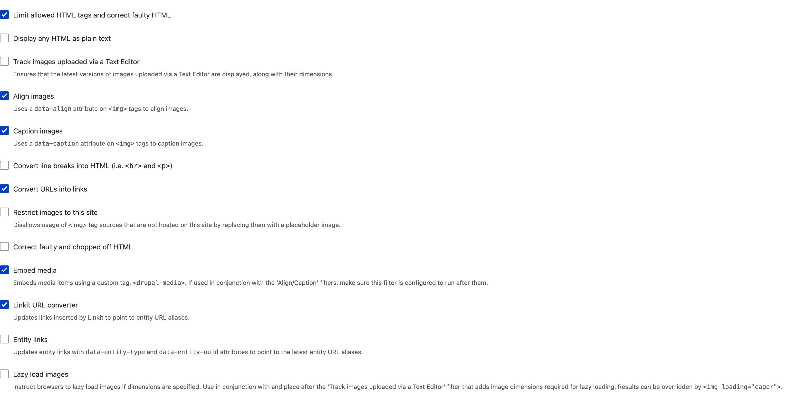

# Text format considerations

As you would have noticed when setting up a text filter, you have the option to limit allowed HTML elements.

<figure><figcaption></figcaption></figure>

This and other options are important to consider when configuring your text formats, as incorrect configuration can lead to opening your site up to cross site scripting attacks.

For example, if you have an unprotected text field with a poorly configured text format in a public facing webform, it is possible that a malicious user could deface, delete, or gain access to the entire website.

Luckily Drupal protects against the vast majority of these potential issues, as does the GovCMS caching service.

However there are still a number of steps you should take to protect your website.

The following are a few examples of things to take into consideration when configuring your text formats.

1. Ensure that all publicly accessible fields (such as in Webforms) use Plain text inputs without the rich text editor toolbar.
2. Educate your content editors about what potential scripts may look like so they don’t accidentally include one by mistake.
3. Ensure your Text formats are properly sanitised.
4. Ensure your theme renders any text using correct render functions, and not simply by outputting the text in a raw format.
5. While sometimes having less restrictions on a text format may be required, you should restrict these more open text formats to trusted user roles.

### Website security is a serious consideration.&#x20;

After weak passwords, cross-site scripting is the next biggest security risk.&#x20;
