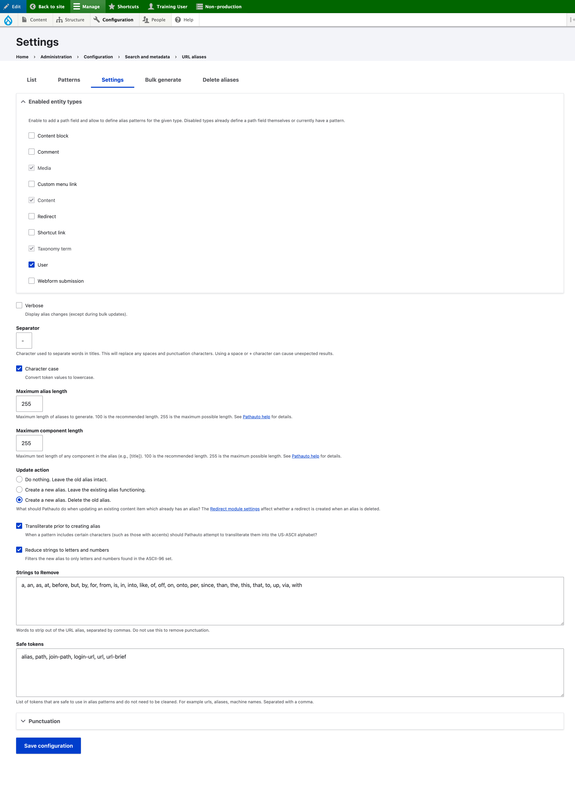
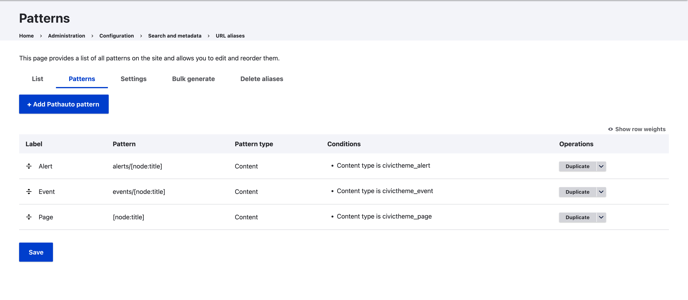

# URL aliases

We covered the majority of this topic when we created our content type in the [Additional settings for content types](../designing-and-planning-content/additional-settings-for-content-types.md#pathauto-url-alias) section.

However, there are more settings for URL aliases that should be understood.

First, go to the **Settings** page by going to **Configuration**, **Search and metadata**, **URL aliases** and then selecting **Settings** from the tab menu.

<figure><figcaption></figcaption></figure>

<figure><figcaption></figcaption></figure>

**Enabled entity types** section allows you to define which entities in Drupal can have URL aliases with patterns. This is rarely ever altered.

**Separator** allows you to define which string should be used to replace spaces. By default this is a simple dash. This is also rarely ever altered.

**Character case** converts all URL aliases to lowercase. This should be left on. All URLs, including aliases and redirects should be lowercase.&#x20;


URLs that are case-dependent can cause consistency issues for users.


**Maximum alias** and **component length** are already set at their maximum values.

**Update action** is important to understand. The third option "Create a new alias, delete the old alias" is the recommended option. This means when a URL alias is changed, Drupal will delete the old alias and the **URL Redirect module** will create a URL redirect for it instead. This helps keep the site's URL management clean.

<figure><figcaption></figcaption></figure>


Pages should only ever have a **single URL** **alias** as their source of truth.


The remaining options concern the alias string itself.

**Transliterate** and **Reduce strings** should both be checked, as these will help make the URL alias more understandable and easier for your visitors.


For example, if you had a page titled "**Déjà vu**" having the URL alias of **/déjà-vu** would make it very inconvenient for standard keyboard users to enter that URL correctly, and if they tried to visit /deja-vu, it wouldn't work, because **é** and **e** are different characters.


Next is which strings should be **automatically removed** when they're detected as part of a URL alias. This is what translates a page title like "As a Director, this is how I like my eggs" which could be /as-a-director-this-is-how-i-like-my-eggs into /director-how-i-my-eggs. This section can be tweaked and improved to suit your needs.

**Safe tokens** is a list of tokens that the patterns can use without being sanitised. This can remain unchanged.

Finally, you can determine how **punctuation** should be handled in the URL alias. Primarily if it should be removed or replaced with a separator.

In the example above we removed the comma after Director, but we could have replaced it with the separator, but that would have ended up with /director--how-i-my-eggs, which isn't as clean.

Very rarely should there be any punctuation in a URL alias.

### Useful tokens

Finally, here are some useful tokens that you can use to build your URL patterns.

<figure><figcaption></figcaption></figure>

#### \[node:title]

This gets the title field of the node, applies the above rules from settings, and is used for pretty much every URL pattern.

#### \[node:menu-link:parents:join-path]

This takes the parent menu items, and joins them to create the path. This is a great way of getting a nested URL alias pattern that matches the menu structure. For example, /about-us/events/good-friday-appeal.

#### \[node:created:custom:?]

This is often used for news or events where you want the URL alias to include the year. The question mark can be replaced with any PHP date variable. So for example \[node:created:custom:Y] could be 2026, or \[node:created:custom:M] could be Jan, Feb, etc.
